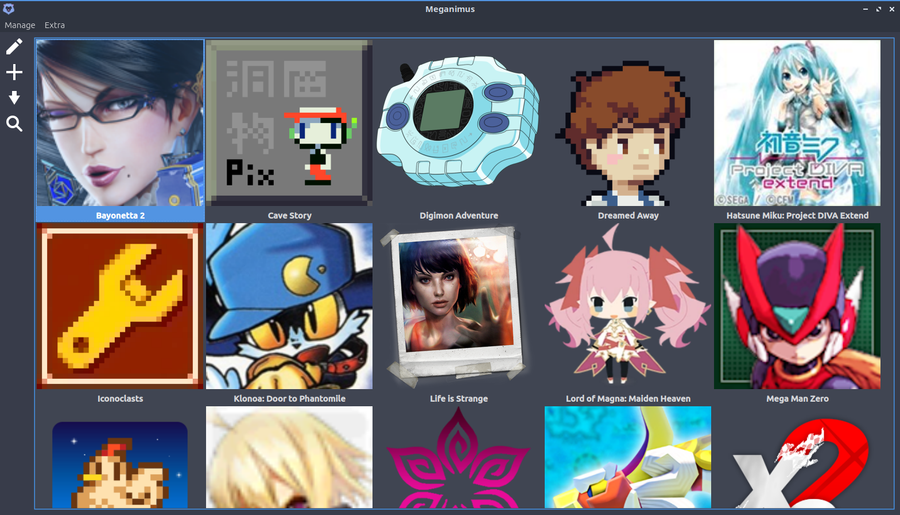

<h1 align="center">

   
  Meganimus
</h1>

  A game shortcut creator

<h1 align="center">

</h1>

  

## Some explanations
- What is Meganimus used for?
  - Meganimus makes it easy to create `.desktop` files for games, whether they are native games, games that run via emulators, or games that run via Wine/UMU.
- What exactly does Meganimus do?
  - Create .desktop files in bulk, updating commands, icons, variables, and arguments based on user choices.
- Is Meganimus a launcher?
  - It's the opposite of that; the idea of ​​creating independent `.desktop` files is about not needing a launcher.
- What's the point of not needing a launcher?
  - Reduce RAM usage and avoid the inconvenience of one app running another.
- Why does the shortcut manager require the user to select folders?
  - This allows Meganimus to use the Document Portal and avoid permission issues.
- About the toolbar.
  - It is possible to hide the toolbar and use the context menu by right-clicking on the menu bar and unchecking the checkbox that appears.
- What happens to `.desktop` files if Meganimus is uninstalled?
  - Nothing, unless the Meganimus folder is deleted, in which case the icons will not be found.
